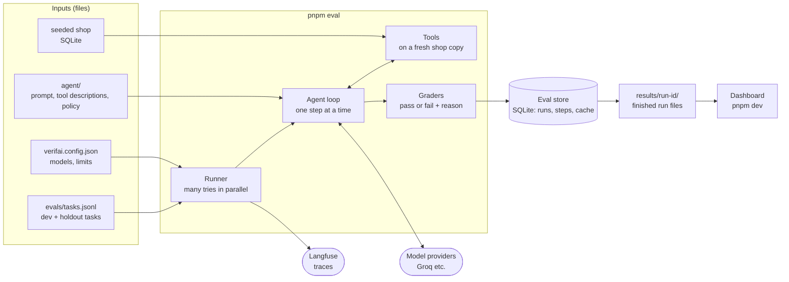
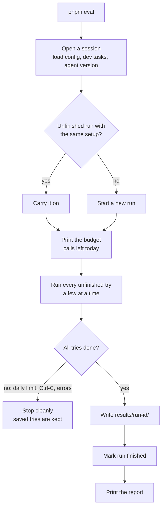
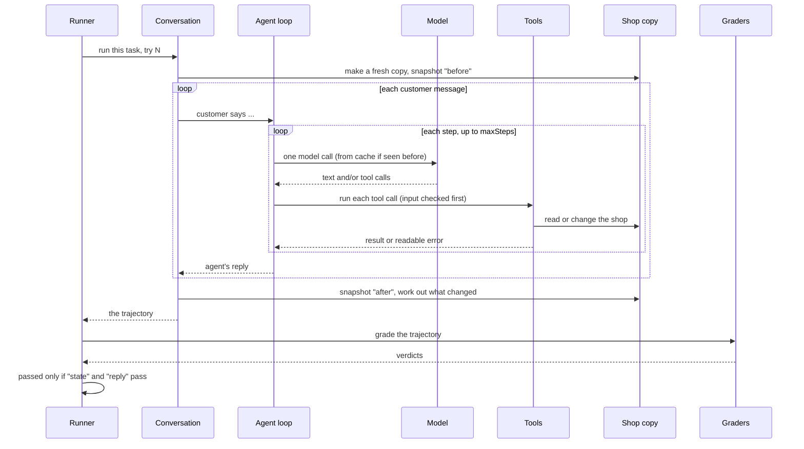
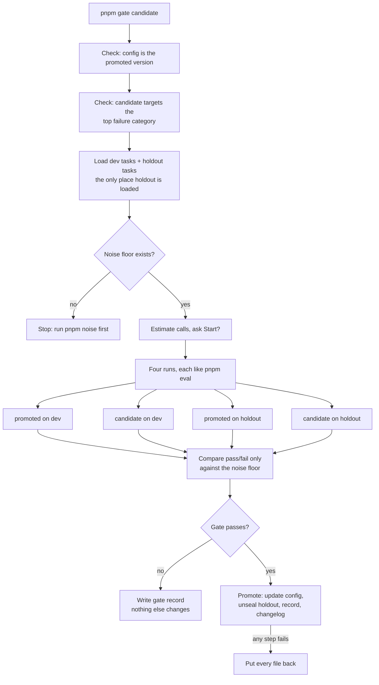
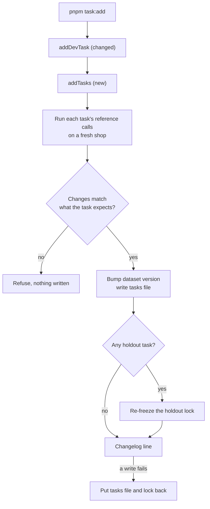
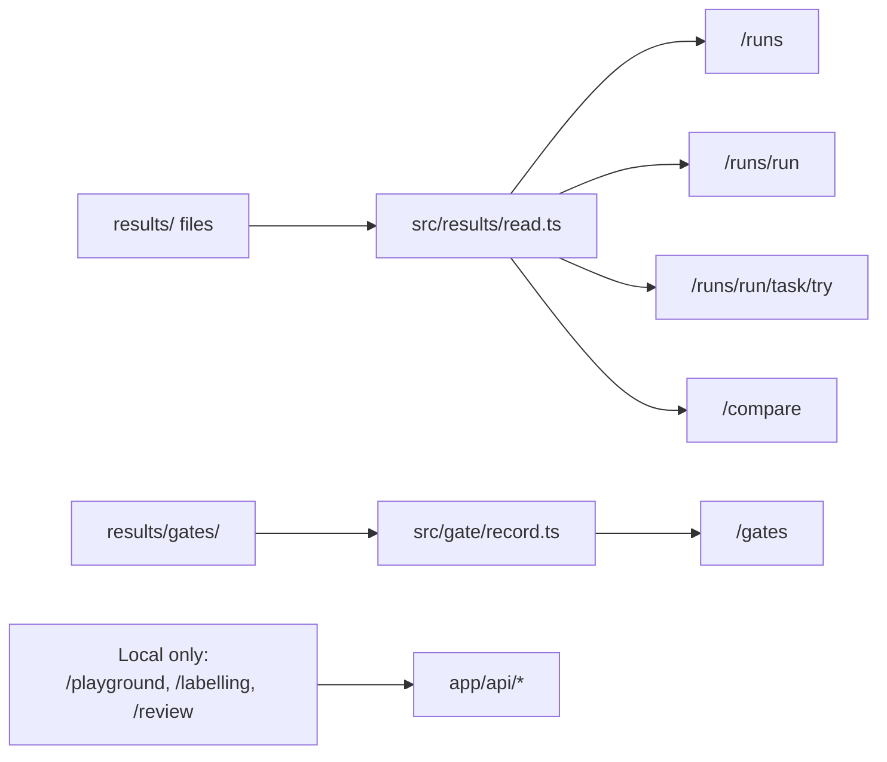

# How VerifAI runs

A map of how the code runs, kept up to date whenever that changes. Each part
starts with a diagram, then explains it in plain words, then gives a table
saying where each step lives in the code.

The diagrams are Mermaid. GitHub draws them. In VS Code, open the Markdown
preview (Cmd+Shift+V) with a Mermaid extension installed, such as
"Markdown Preview Mermaid Support".

Current task: Phase 11 follow-up, uncommitted on branch `phase-11-gate`.
Places it changed are marked **changed** and listed at the end.

---

## 1. The big picture

### What it shows

VerifAI has one main job: run the support agent on every task several times,
grade each try, and save the results.

- **Inputs** are plain files: the config, the tasks, the agent's prompt and
  tools, and a seeded shop database.
- **The runner** takes each task and runs it a few times ("tries"), several
  at once.
- **The agent loop** talks to the model one call at a time. When the model
  asks for a tool, our code runs it on that try's own copy of the shop.
- **Graders** read what happened in the try and decide pass or fail.
- **The eval store** (SQLite) is the workshop. Every try, step and model
  reply is saved there as it happens, so a stopped run carries on later.
- **results/** is the record. Once a run is finished it's written there as
  files, and the dashboard reads only those files.

### The two rules the picture enforces

- **Each try gets a fresh shop.** One try can never change what another sees.
- **The dashboard never runs anything.** It only reads finished files.

---

## 2. `pnpm eval`: one full run

### Step by step

#### Opening a session
The script reads the config and loads the **dev** tasks only, never the
holdout. It loads the agent version (prompt, tool descriptions, policy),
connects to each model provider in the pool, opens the eval store, and turns
on Langfuse tracing.

#### Starting or resuming a run
A run is identified by a fingerprint of its whole setup. If an unfinished run
has the same fingerprint, it carries on from the next unfinished try instead
of starting over.

#### The budget
Before spending anything it prints how many calls are left and whether they
fit in today's free limit. Tries already in the cache cost nothing.

#### Running the tries
Every unfinished (task, try) pair runs, a few at once. Section 3 explains one
try.

#### Stopping or finishing
If the daily limit runs out, you press Ctrl-C, or too many tries error in a
row, it stops cleanly. Finished tries stay saved. When every try is done, the
run is written to `results/<run>/` and only then marked finished. So if
writing the files fails, the next `pnpm eval` writes them again.

### Where in the code

| Step | File | Function |
|---|---|---|
| Entry | scripts/eval.ts | `main` |
| Open a session | src/eval/session.ts | `openSession` |
| Load config | src/config.ts | `loadConfig` |
| Load tasks | src/tasks/load.ts | `loadTasks` |
| Load agent version | src/agent/versions.ts | `loadAgentVersion` |
| Start or resume, budget, finish | src/eval/session.ts | `executeRun` |
| Run the tries | src/eval/runner.ts | `runTrials` |
| Write results | src/results/write.ts | `writeResults` |

---

## 3. One try, up close

### The conversation
Each task has a first customer message and a list of canned replies. The
customer speaks, the agent answers, the next canned reply goes in, and so on
until the replies run out.

### The agent loop
Within one agent turn, the loop makes one model call per step. If the model
asks for tools, our code runs them and feeds the results back, then makes the
next call. It stops when the model just replies, or after `maxSteps` steps.
The AI SDK never runs this loop itself, so every step is recorded.

### Each model call
Before sending a call, the runner checks the cache. A seen call is replayed for
free. Otherwise it picks the first provider in the pool with room left this
minute and today, sends the call, and saves it to the cache.

### Tools
A tool's input is checked with Zod before it runs. Bad input becomes an error
message the model can read, never a crash.

### Grading
The **trajectory** (every message, tool call and result, plus what changed in
the shop) goes to the graders. Many graders report, but only two decide
pass or fail:

- **state**: did the shop end up changed exactly as the task expects?
- **reply**: did the agent tell the customer the right facts? **changed:** it
  now also fails if the agent names another customer's id, or says it
  transferred the customer when no transfer happened.

The rest (tool choice, arguments, policy rules, efficiency, loops, made-up
facts) are reported beside them so you can see *why* a try went the way it
did.

### Where in the code

| Step | File | Function |
|---|---|---|
| One try | src/eval/runner.ts | `runOne` |
| Each model call (cache, provider, limits) | src/eval/runner.ts | `wrapCall`, `pick` |
| Conversation | src/eval/conversation.ts | `runTaskConversation` |
| Agent loop | src/agent/loop.ts | `runAgentTurn` |
| Tools | src/agent/tools.ts | `runTool` |
| All graders | src/graders/index.ts | `gradeTry` |
| Reply outcome **(changed)** | src/graders/index.ts | `gradeReplyOutcome` |
| Pass or fail | src/graders/index.ts | `outcomePassed` |

---

## 4. `pnpm gate <candidate>`: deciding whether a change ships

### What the gate is for
A **candidate** is a proposed change to the agent (a new prompt, new tool
descriptions, and so on). The gate decides whether it beats the current
**promoted** version without breaking anything.

### Checks before spending anything
- The config must be exactly the promoted version.
- The candidate must target the biggest failure category in the taxonomy.
- A **noise floor** must exist. That's how much a score moves between two
  runs of the *same* agent. A change smaller than that isn't an improvement.

### The four runs
Both versions run on dev and on the **holdout**, the tasks set aside that are
never used to make fixes. Runs already finished are reused.

### The decision
It compares only pass or fail per try, so no holdout conversation is ever
read. A category fails only if it drops by more than its limit: the larger
of 5 points (the config's minimum) and the promoted version's noise floor
for that category, rescaled to its task count on that split and rounded down
to 0.1 (D-002). The candidate's own floor never widens it. Each limit is saved in the gate record. If the gate fails, a record is written and nothing else changes. If it
passes, the candidate is promoted, all in one step: if any part fails, every
file is put back.

### Where in the code

| Step | File | Function |
|---|---|---|
| Entry | scripts/gate.ts | `main` |
| Read candidate | src/gate/candidates.ts | `readCandidate` |
| Check promoted | src/gate/promoted.ts | `checkConfigIsPromoted` |
| Load holdout | src/tasks/load.ts | `loadTasks({ gating: true })` |
| Noise floor | src/results/read.ts, src/gate/floor.ts | `readNoiseFloors`, `rescaleNoise` |
| Each run | src/eval/session.ts | `openSession`, `executeRun` |
| Compare | src/stats/report.ts | `compareRuns` |
| Decide | src/gate/check.ts | `decideGate` (takes the promoted floor, returns the limits it used), `categoryDropLimit` |
| Record | src/gate/record.ts | `gateComparison` (saves the limits the decision used), `writeGateRecord`, `addChangelogEntry` |

---

## 5. `pnpm task:add`: adding a task

### What changed here
Adding one dev task used to do all the work itself. Now it calls a new
`addTasks`, which can add several tasks in one dataset bump. If any of them
goes to the holdout, the holdout is re-frozen in the same step and the
changelog says so.

### Safety checks
Every new task's reference calls are run on a fresh shop first. If they don't
produce exactly the changes the task expects, nothing is written.

### Worth knowing
No script calls `addTasks` directly yet. Only its tests do.

### Where in the code

| Step | File | Function |
|---|---|---|
| Entry | scripts/task-add.ts | `main` |
| Add one dev task **(changed)** | src/tasks/load.ts | `addDevTask` |
| Add several **(new)** | src/tasks/load.ts | `addTasks` |
| Run reference calls | src/eval/conversation.ts | `runReference` |

---

## 6. The dashboard (`pnpm dev`)

### Read-only pages
Runs, a single run, a single try, compare and gates all just read files from
`results/`. They never call a model.

### Local-only pages
The playground, labelling and review pages call a model or write files, so
they work only on your machine and are hidden when deployed.

---

## 7. Other commands (not mapped yet)

`pnpm noise`, `compare`, `regrade`, `claims`, `judge`, `judge:bias`,
`agreement`, `taxonomy`, `tasks:freeze`, `task:new`, `exemplars:add`, `seed`
and `chat` each have one script in `scripts/`. They'll get a section when a
task touches them.

---

## Changed in this task

| Where | What |
|---|---|
| src/graders/index.ts:23 | `gradeReplyOutcome` (new): reply also fails on a leaked customer id or a false transfer |
| src/graders/policy.ts:68 | `otherCustomerNamed` (new) |
| src/graders/policy.ts:82 | `identifyFirst`: fails on a leaked customer id |
| src/graders/policy.ts:253 | `ESCALATED`: transfer wordings added |
| src/graders/policy.ts:271 | `falseEscalation` (new) |
| src/graders/policy.ts:287 | `promises` (new): skips questions, negations and repeats of the ask |
| src/graders/policy.ts:290 | `noFalsePromises`: uses `falseEscalation` and `promises` |
| src/tasks/load.ts:186 | `addDevTask`: now calls `addTasks` |
| src/tasks/load.ts:198 | `addTasks` (new) |
